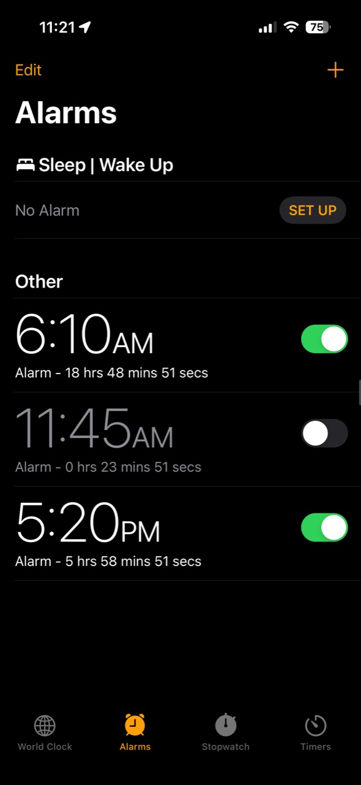

# Sleep Left

**Time remaining. Right in Clock.**

See the hours, minutes and seconds until your alarms, updated live in Apple's
Clock app. Sleep Left adds the countdown beneath each ordinary alarm, alongside
your existing label.
Enabled and disabled alarms both show a countdown; a disabled alarm's countdown
previews its configured next occurrence and does not mean it will ring.

Free and MIT licensed. Independently developed by **0chium**, inspired by
**AlarmTime by P2KDev**.

## In Clock

Live countdowns beneath ordinary alarms. The gray, disabled alarm is a preview and stays off.

## Install and use

1. Add **https://0chium.github.io/** to Sileo and refresh sources.
2. Install **Sleep Left**.
3. Fully close and reopen Clock, then open Alarms.

The countdown appears automatically. No Settings pane or extra configuration.

Use a compatible conventional rootless jailbreak with a Substrate-compatible
tweak loader. The package contains arm64 and arm64e slices and depends on
`mobilesubstrate` and iOS 17–18. Those version bounds do not establish support
for every build; the specific tested configurations are listed below.

If you already use another alarm-countdown tweak, disable or remove that tweak
before using Sleep Left so only one modifies the alarm rows.

## Compatibility

| Device | iOS | Build |
| --- | --- | --- |
| iPhone 14 Pro | 17.0 | 21A329 |
| iPhone 11 Pro Max | 18.3.2 | 22D82 |

The owner reports that **0.1.0~alpha1** passed the initial functional checks on
both configurations without another alarm-countdown tweak active: enabled and
disabled countdowns, custom labels, editing and toggling, scrolling without
duplicate or mismatched text, and correct catch-up after returning to Clock.

The final **0.1.0** package retains the same implementation with release branding
and metadata changes. It has not received additional device testing. These are
specific owner-reported results, not a blanket compatibility claim.

## Limitations

- Sleep/Wake Up alarms are not included.
- Snooze duration, alarm scheduling and firing are unchanged.
- Other device, OS and bootstrap combinations, including RootHide conversion,
  are unverified. iOS 26 is unsupported.
- Recurrence/DST boundaries, time-zone changes and snooze-state edge cases have
  not been comprehensively tested.
- VoiceOver custom content, large accessibility text and timer inactivity have
  not been verified by owner testing. No battery, CPU or reliability measurements
  are claimed.
- Countdown units are currently English. Apple's original subtitle retains its
  native text and formatting. An unsupported model/layout or missing future
  date leaves the native row unchanged.

## Implementation and what we learned

- **Apple supplies the next occurrence.** We read the date from Clock's alarm
  model rather than implementing an alarm scheduler or changing its state.
- **Native subtitle and controls.** We append to Apple's formatted subtitle,
  preserving labels, fonts, enabled/disabled colors and controls. A narrow width
  adjustment provides space for the countdown using native row sizing.
- **One visible-list timer.** One timer updates visible ordinary alarm rows once
  per second while the list is active. It stops when the controller or scene is
  inactive. Each update subtracts current wall time from Apple's occurrence date
  so delayed ticks catch up.
- **No accumulating suffixes.** Native refreshes replace the stored base text
  and alarm model. Each update regenerates the countdown from that original text;
  cell reuse clears the association.
- **On-demand VoiceOver content.** The countdown is offered as custom content
  while preserving Apple's time/on-off speech and actions. This remains
  unverified by owner testing.

Foregrounding, native refreshes and relevant time/time-zone notifications
invalidate cached visible dates. These are our implementation choices, not
claims about AlarmTime's internals or comparative performance.

## Source, support and credits

- [Source](https://github.com/0chium/SleepLeft)
- [Support and issue reports](https://github.com/0chium/SleepLeft/issues)
- [Package page](https://0chium.github.io/depictions/sleepleft.html)
- [Changelog](CHANGELOG.md) · [Build instructions](BUILDING.md) · [MIT license](LICENSE)

**Inspired by AlarmTime by P2KDev. Independently implemented.**

P2KDev is credited for the inspiration. Sleep Left is our independent
implementation, not a repackaged AlarmTime binary or an endorsed continuation.
No AlarmTime code or artwork is included. Original code and approved crescent
artwork are MIT licensed. Apple frameworks
and the device-provided hook library retain their ownership and are not
redistributed.

For issue reports, include the Sleep Left version, device model, iOS/build,
jailbreak and a description of the problem. Mention other Clock tweaks if
relevant. Screenshots are optional; remove private information from public
attachments.

Package identifier: `com.ochium.sleepleft`.
